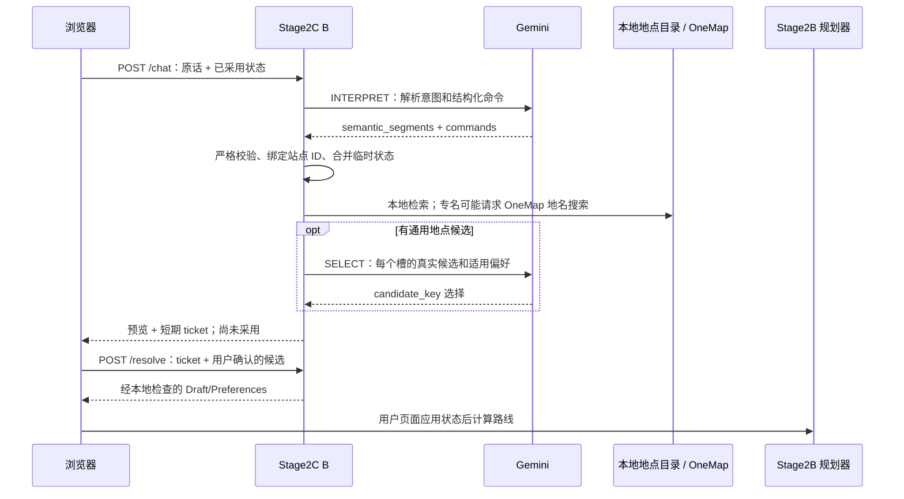

# Person B 输入、输出与模型上下文契约

状态：与当前工作区的 `2C1-F9.1` prompt/wire 实现对应；基线分支为 `b/dialogue-semantics-v1`，基线提交 `e516f3359f5e734b48394e1cb56887ab5b0a18c7`。本文件不把 C 分支能力算作已接入。

## 一条请求怎样走完

B 的所有权分四层。浏览器保存已采用的 `Draft` 和 `Preferences`；B 检查它们并返回待确认提案；模型只能提出意图和真实候选的选择；Stage2B 在浏览器实际应用后计算路线。`/chat` 不会改动已采用行程。

| 层 | 主要对象 | 写入者与责任 |
|---|---|---|
| 浏览器 ↔ B API | `ChatRequest`、`ResolveRequest` | 浏览器发送原话及当前已采用状态；B 返回提案或可采用的新状态 |
| 模型协议 | `semantic_segments`、operation-scoped `commands`、SELECT `picks` | Gemini 提议意图或从候选中选择；不能写坐标、可信核验来源或已满足状态 |
| B 内部状态 | 规范化 `Interpretation`、`ActiveConstraint`、候选槽、ticket | 本地代码负责校验、作用域绑定、约束合并、组装与阻断 |
| 规划器交接 | `Draft`、`Preferences`、`ready_to_calculate` | `/resolve` 返回值；浏览器确认采用后交给 Stage2B 计算 |

## API 输入中的状态字段

入口模型在 [`models.py`](../app/stage2c/models.py#L144)；API 入口在 [`api.py`](../app/stage2c/api.py#L65)。这些字段有明确的所有权：

| 路径 | 类型 / 规则 | 为什么需要 | 谁写入 | 缺省、null 与失败行为 |
|---|---|---|---|---|
| `session_id` | 32 位小写十六进制字符串 | 隔离短期 ticket、核验与并发请求 | 浏览器 | 缺失或格式错误返回 422；不是账号 ID |
| `revision` | 非负整数 | 拒绝基于旧行程的提案 | 浏览器 | resolve 时必须和 ticket 的 revision 相同，否则 409 |
| `message` | 1–3000 字符 | 当前轮的唯一新指令来源 | 用户经浏览器输入 | 空白或控制字符输入拒绝；原文会送到 Gemini |
| `draft` | `Draft` | 说明当前已采用起点、站点、时间和路线条件 | 浏览器 | B 返回新副本；只在前端确认采用后更新 |
| `preferences` | `Preferences` | 跨轮保存主题、排除、备注和约束账本 | 浏览器随每轮往返；B 在提案副本上合并 | 未提供时为空对象；未确认提案不会写回浏览器状态 |
| `pending` | `Pending` | 把尚未采用请求的上下文带到下一轮 | 浏览器 | null 表示没有待确认上下文；取消后清除 |
| `consent` | boolean，必须为 true | 明确用户同意发送当前对话给 Gemini | 浏览器 | false 时发送前拒绝；不自动探测模型 |
| `verification_ref` | 32 位十六进制，可省略 | 只恢复同一 session/revision/draft/目录快照的核验结果 | B 返回，浏览器短期携带 | 缺失、过期或快照改变会把核验降为未核验 |

`Draft` 字段来自 [`models.py`](../app/stage2c/models.py#L59) 和 [`stage2b/models.py`](../app/stage2b/models.py#L11)：

| 字段 | 含义与单位 | 必要性 / 重要限制 |
|---|---|---|
| `origin`, `finish` | `PlacePoint`，坐标、来源与目录引用 | 路线计算需要位置；来源代表点不等于已核验入口 |
| `visits[]` | `Visit`，稳定 `visit_id`、地点、停留分钟、`stay_profile` | 站点身份在移动/替换后仍稳定；分钟数可空，不会被改成 0 |
| `finish_policy` | `last_stop`、`return_to_start` 或本地 `custom` | 区分行程结束方式 |
| `mode` | `walk`、`drive`、`cycle` | Stage2B 当前输入方式；公交/地铁命令会明确报未接入 |
| `time` | estimate / budget / window、时刻、预算、buffer | 给现有时间预算检查提供明确参数；日期时间必须有 UTC offset |
| `max_walk_minutes` | 正整数分钟或 null | 逐段步行上限的执行参数；null 只有和明确撤回一起才表示清除 |

`Preferences.active_constraints` 中另有一份稳定账本：

| 字段 | 规则 | 为什么需要 |
|---|---|---|
| `name`、`kind` | 字段名；`constraint` 或 `preference` | 让相同名字的要求与偏好保持不同语义 |
| `value` | 字符串、数值、布尔值或 null | 保存用户值；集合字段一条记录只存一个成员 |
| `scope` | 全局、端点、站点或未来新增站点 | 避免把“第二站喝茶”污染到其他站 |
| `hardness` | `hard`、`soft`、`unknown` | hard 条件可阻断；soft 条件不能被升级为硬过滤 |
| `status` | `understood`、`unresolved`、`satisfied`、`conflicting`、`unsupported` | 分开“模型理解”与“本地检查结果” |
| `source` | 新记录为 `user_explicit` 或 `inferred` | 记用户意图来源；不拿核验结果覆盖它 |
| `evidence_source` | 可选 `route` 或 `catalogue` | 单列确定性核验证据来源；重新计算/过期后清空 |
| `quote`、`turn_index` | 原话短片段及本地轮次 | 追溯依据、处理新旧更新；轮次由应用生成 |

旧保存对象中 `source=route/catalogue` 仍可读。该旧值不能证明原始意图来源；代码不会把它伪造改成 `user_explicit`。新核验证据写入 `evidence_source`。

## 语义段、作用域与确定性更新

provider 输入 schema 在 [`command_contract.py`](../app/stage2c/command_contract.py#L55)，严格 live parser 在 [`operation_adapter.py`](../app/stage2c/operation_adapter.py#L199)。provider 必须给每个 segment 提供九个字段：

| 字段 | 允许值 / 作用 | 为什么需要 |
|---|---|---|
| `type` | `operation`、`constraint`、`preference`、`preserve`、`conflict` | 分开行动、条件、偏好、保留意图与冲突 |
| `name` | [`requirement_fields.py`](../app/stage2c/requirement_fields.py) 中的规范字段名 | 作为稳定的更新和能力查询键 |
| `value` | string / number / boolean / null | 保存原始意图值；不写模型坐标或核验结论 |
| `scope` | 下表定义的范围 | 将局部意图绑定到正确站点或端点 |
| `hardness` | hard / soft / unknown | 控制更新、阻断和候选排序 |
| `status` | understood / unresolved / conflicting / unsupported | 明示模型的不确定或无法支持项 |
| `source` | user_explicit / inferred | 区分用户明确说出与模型推断 |
| `quote` | 当前或 pending 原话中的精确子串，1–240 字符 | 验证字段有输入依据，不让模型引用应用上下文 |
| `effect` | set / clear / none | 区分新增、撤回和不更新；省略、false、0 与 null 不混用 |

provider 不能输出 `satisfied`、`route/catalogue`、`turn_index` 或持久 `visit_id`。本地应用在 [`semantic.py`](../app/stage2c/semantic.py#L72) 执行 reducer；同一 scope 的集合字段可以逐成员删除，集合全清用 null。软 clear 不会删掉原 hard 条件。

| scope | 含义与来源 | 接受范围 / 失败行为 |
|---|---|---|
| `global` | 整个行程 | 大多数全局偏好与限制 |
| `origin`、`finish` | 起点或终点 | 端点动作；无对应操作时不擅自改端点 |
| `visit:N` | 当前 Draft 的第 N 站 | 每轮按当前顺序解析，再绑定稳定 ID；`stay_minutes` 必须明确一个当前站 |
| `visit:new` | 唯一新增站 | 只有一项新增时接受；多个新增必须用 `visit:new:N`，否则拒绝歧义 |
| `visit:new:N` | 第 N 个新增站 | 本轮新增序号，随后绑定对应预留 ID |
| `future_visits` | 只影响未来新增站 | 仅 `excluded_topic` 使用；不会把已有站点自动删掉 |
| `time_window:N` | 第 N 个活动时段 | 当前只保留并标记 unsupported；不声称规划器已执行 |
| `visit_id:ID` | 持久站点身份 | 仅本地绑定后的 Preferences 使用；provider 不能编造或发送此 scope |

系统级参数 `max_walk_minutes`、`budget_minutes`、`departure_at`、`finish_by`、`transport_mode`、`finish_policy` 只能是 global。`excluded_topic` 只允许 global/future_visits；`takeaway` 必须指向 visit 或新增 visit。局部排除不会被扩大成全局排除。

`clear` 对标量必须是 `value:null`；对 set 字段，`value:"museum"` 仅撤回 museum，`value:null` 清空当前 scope。set 字段使用一条 segment 一个字符串成员。clear 必须有明确撤回原话。clear 之外的未知字段不会被静默丢弃。

## 字段注册表：字段为什么存在

字段注册及能力理由以 [`requirement_fields.py`](../app/stage2c/requirement_fields.py) 为准。没有能力的字段仍保留到用户可见状态，不会被宣称已验证。

| `name` | 值类型 / cardinality | 典型 scope | 能力 | 为什么需要 / 不能证明什么 |
|---|---|---|---|---|
| `place_type` | string / scalar | visit:N、visit:new:N | catalogue_type | 细分 park/cafe/restaurant/museum，避免五大类过宽 |
| `category` | string / scalar | visit | catalogue_type | 保留五类召回类别的明确限制 |
| `keyword` | string / set | visit | catalogue_text | 每个属性独立保存，检索时可全部执行 hard AND 条件 |
| `max_walk_minutes` | integer 分钟 / scalar | global | route | 交给现有逐段路线检查；不等于搜到路线范围内候选 |
| `budget_minutes` | integer 分钟 / scalar | global | budget | 交给现有总时间检查 |
| `departure_at` | 带 offset 的日期时间 / scalar | global | parameter | 保留用户选定的出发时刻 |
| `finish_by` | 带 offset 的日期时间 / scalar | global | parameter | 保留用户明确的结束时刻 |
| `transport_mode` | enum string / scalar | global | parameter | 选择支持的路线方式；public transport 目前不接入 |
| `stay_minutes` | integer 分钟 / scalar | visit:N | parameter | 保留站点级明确停留时长，不能当成所有站共用默认值 |
| `finish_policy` | enum string / scalar | global | parameter | 区分最后一站结束或回到起点 |
| `takeaway` | boolean / scalar | visit / visit:new:N | parameter | 选择目录提供的外带时长档；不是 LLM 编造分钟数 |
| `excluded_topic` | Topic string / set | global、future_visits | catalogue_filter | 记住排除项和作用范围；soft 值不升级为硬过滤 |
| `theme` | Topic string / set | global 或特定 visit | preference | 让多个独立兴趣可以累积和逐项撤回 |
| `drink` | string / scalar | visit | preference | 将咖啡/茶绑定到具体餐饮槽，而不是全局饮食偏好 |
| `pace` | qualitative string / scalar | global 或 visit | preference | 保留“轻松”等意图，不猜分钟数 |
| `environment` | string / set | visit | unverified_attribute | 保留 indoor/outdoor；目录不能可靠证明场所属性 |
| `walking_effort` | qualitative string / scalar | global | preference | 保存少走路偏好，不撤回数值步行上限 |
| `duration` | qualitative string / scalar | global | preference | 保留“玩一天”等时长表达，不猜行程预算 |
| `opening_hours` | string 时间 / scalar | visit | unverified_attribute | 记录营业要求；OSM/旧资料不足以保证未来实际开门 |
| `wheelchair_access` | string / scalar | visit | unsupported | 明示无可靠无障碍数据或全程无台阶验证能力 |
| `dietary` | string / set | visit | unverified_attribute | 保留每项饮食要求，不声称菜单已核实 |
| `radius_m` | 正数米 / scalar | visit 或 global | spatial | 仅做直线半径过滤；不等于步行时间或网络距离 |
| `spatial_anchor` | 地点名 / scalar | visit 或 global | spatial | 把“Bugis 附近”的中心与目标类别分开 |
| `area` | string / scalar | visit 或 global | unsupported | 保留区域意图；当前没有权威区域求解器 |
| `time_window` | string / scalar | time_window:N | unsupported | 保留各活动时间窗；当前无法按每站窗口排程 |

`capability_summary()` 会把每个字段的 `capability`、cardinality 和 reason 传入 INTERPRET。以上每项元数据的用途是收紧解析和说明限制；未用一个未经校准的 confidence 阈值代替验证。

## 模型输入和输出

### INTERPRET 输入

构造位置：[`engine.py::_prepare`](../app/stage2c/engine.py#L397)。发送对象的键为：

| 键 | 内容 | 发送边界 |
|---|---|---|
| `user_message` | 当前轮原文 | 原文会发给 Gemini |
| `current_draft` | 起点/站点的类别、位置标签来源、时间和约束参数 | 私人地图点不发送其 label/坐标；目录/OneMap 公开标签可发送；不发送 Draft 坐标 |
| `preferences` | 已采用的 `Preferences`，含约束 value、quote、scope 和状态 | 仅已采用账本；quote 可能含用户原话；核验状态会在新轮前失效或重查 |
| `pending_request` | pending 的累计消息与其 commands/segments | 未采用；消息最多保留最近 3000 字符 |
| `singapore_now` | 服务端新加坡时间，秒级 | 用来解析相对日期；不能替用户猜具体出行日期 |
| `capabilities` | 每字段名称、能力、cardinality 和理由 | 用于提示可执行范围；不是实时目录事实 |

模型输出：`acknowledgement`、`semantic_segments[]`、operation-scoped `commands`、可选 `questions` 及兼容字段。模型命令字段不允许通用 `value`；目标站点使用 1 起算的 `target_position`，本地按请求时 Draft 快照解析成目标 ID。

### 候选 SELECT 输入

仅在 generic location slot 有可选项时发第二次模型请求。每个槽有 `slot_id`、顶层类别、`applicable_preferences` 和本地检索返回的 candidates。每个候选包含 `candidate_key`、名称、类别、地址、来源说明、建议时长及来源、营业参考及来源、入口数、细类依据和距离带。坐标、私有路线几何及精确距离留在本地。`applicable_preferences` 已按该槽目标过滤：global、该站点 ID，以及新增站专属的 future_visits；不同咖啡/茶槽不会共享错偏好。实现见 [`selection_preferences()`](../app/stage2c/engine.py#L197)。

SELECT 只返回 `{ "picks": [{"slot_id", "candidate_key", "reason"}] }`。B 要求每槽恰好一次、key 存在、身份不重复；它不接受模型创造地点。建议、营业时间文字或目录停留时长不是现实营业/入口/时间预算核验。

### 本地可执行命令与外带编译

外部 command contract 仍是 `operation_scoped_commands_v1`，每个操作有自己的参数；provider 不发送内部 `stay_profile` 字段。provider 的 scoped `takeaway` segment 经 [`compile_takeaway_actions()`](../app/stage2c/semantic.py#L229) 转成 `LocationAction.stay_profile` 或带目标 ID 的 `StayAction`，随后经过同一 `preserve` 检查与 `assemble()`。因此 segment 不会在 Draft 组装后被旁路执行。这个内部 action 字段在 API 的规范化 `interpretation.actions` 中可见。

`set_stay` 命令会在同一待采用 Preferences 副本中覆盖/清除对应的 `stay_minutes` constraint；否则 Draft 可能是 60 分钟而账本仍写 30 分钟。实现见 [`synchronize_action_constraints()`](../app/stage2c/semantic.py#L140)。Draft 和 Preferences 只在 `/resolve` 返回后由浏览器一起采用。

## ID、票据和状态寿命

| 对象 | 含义 | 寿命 / 边界 |
|---|---|---|
| `visit:N` | 本轮模型所见当前第 N 站 | 仅当前 Draft 顺序；不能跨轮保存 |
| `visit:new:N` | 本轮第 N 个新站 | 绑定成功后变成稳定 ID |
| `visit_id:ID` / `visit_id` | 已保存站点身份 | 随站点移动；删除站点时清理该站约束 |
| `slot_id` | 本轮检索槽，例如 `s0` | 只标识这份 ticket 内候选组 |
| `candidate_key` | 本轮真实候选 key | 只可在对应槽/ticket 使用 |
| `ticket` | B 内存中的完整提案句柄 | 10 分钟或服务器重启/容量淘汰后失效；绑定 session/revision/目录版本 |
| `verification_ref` | 计算后的局部核验句柄 | 10 分钟；绑定 session/revision/Draft fingerprint/catalogue build |
| `turn_index` | B 本地递增的对话顺序 | 为 ledger 排序；不是前端 revision |
| `revision` | 已采用行程版本 | 每次用户本地采用/编辑后变化；用于防止旧提案覆盖新状态 |

`can_apply=true` 代表结构化提案无已知阻断、所有候选槽已满足；不表示用户已确认或路线现实可行。`ready_to_calculate=true` 代表 Draft 含可计算的起点和站点等最低字段；不代表营业时间、入口或外部路线约束已核验。`satisfied` 只来自匹配的确定性 verifier；候选模型选择不产生 satisfied。

## 代码定位

| 责任 | 主要位置 |
|---|---|
| Draft/segment/Preferences/API 数据模型 | [`models.py`](../app/stage2c/models.py#L19) |
| provider JSON schema 与命令编译 | [`command_contract.py`](../app/stage2c/command_contract.py#L55) |
| provider 权限、scope、值和 quote 检查 | [`operation_adapter.py`](../app/stage2c/operation_adapter.py#L199) |
| INTERPRET/SELECT 规则 | [`prompts.py`](../app/stage2c/prompts.py#L1) |
| prompt/wire 版本 | [`wire_schema.py`](../app/stage2c/wire_schema.py#L17) |
| 约束字段/理由/能力 | [`requirement_fields.py`](../app/stage2c/requirement_fields.py) |
| ledger reducer、scope 绑定、证据来源、参数一致性 | [`semantic.py`](../app/stage2c/semantic.py#L72) |
| 请求上下文、检索、SELECT payload、preview | [`engine.py`](../app/stage2c/engine.py#L397) |
| 地点细类、排除与候选证据 | [`catalogue.py`](../app/stage2c/catalogue.py#L1) |
| ticket/resolve/核验 API | [`api.py`](../app/stage2c/api.py#L56) |
| UI pending、确认、取消和 proof 失效 | [`chat.js`](../frontend/stage2c/chat.js#L82) |
