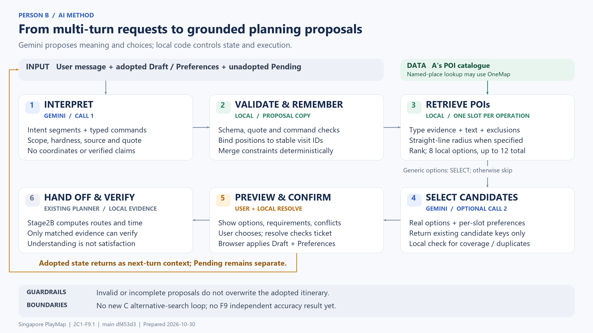

# Person B · AI 对话理解与约束管理

供 GE5226 Singapore PlayMap 的 PPT 制作者使用。整理日期：2026-10-30；依据本地 `main` 提交 `df453d3`，prompt/wire 版本 `2C1-F9.1`。本文没有核查线上部署或远端后续更新。

## 先用这一句话介绍 B

**B 将用户的多轮出游需求转成带作用范围、来源和更新规则的结构化规划提案，从真实地点候选中推荐地点，并在用户确认后交给现有规划器。**

英文可直接用于 PPT：

> We translate multi-turn travel requests into structured planning proposals, preserve scoped constraints across turns, and ground recommendations in retrieved POIs before user confirmation.

这里的 semantic segmentation 指**把对话拆解为操作、约束、偏好、保留意图和冲突**，不是图像分割。实现使用 Gemini 的结构化输出与本地确定性规则，没有自行训练分割网络，也没有微调模型。

## 图怎么使用

- `PERSON_B_METHOD.png`：3200 × 1800，16:9，可直接插入 PPT。
- `PERSON_B_METHOD.svg`：矢量版，适合缩放；如需拆成形状，取决于 PowerPoint 版本。
- `PERSON_B_METHOD.mmd`：可编辑的方法图源码，适合增删节点。

图中蓝色为 LLM，绿色为本地规则与检索，橙色为用户确认，灰色为已有规划器或尚未接入的能力。图中的回路表示采用后的状态会进入下一轮；不是让模型自行反复搜索直到找到可行路线。



## B 为什么需要这些设计

| 实际问题 | B 的处理方法 | 对产品的作用 |
|---|---|---|
| “找咖啡馆”被扩大成任何餐饮 | 五大类召回之外保留 cafe/restaurant 等细类，用来源类别证据过滤 | 减少只搜到 hawker centre 的类型错配；不能弥补目录本身缺失 |
| 用户调序后，“第二站”的要求挂错地点 | 本轮序号先绑定稳定 `visit_id`，持久账本跟随站点身份 | 避免调序后将咖啡偏好、停留时长应用到另一站 |
| “少走一点”覆盖“每段最多 5 分钟” | 区分 hard/soft/unknown，软偏好不能撤回旧硬约束 | 用户未明确取消的数值上限继续保留 |
| 理解了要求，却没有对应执行参数 | 对语义段和命令做一致性检查；未知能力保留为未核验/不支持 | 减少静默丢失需求及虚假完成承诺 |
| 模型推荐不存在的地点或擅自改行程 | 地点由本地目录/OneMap 返回；模型只能选候选 key；采用需要用户确认 | 地点来源、提案与已采用行程可以区分 |

这些属于结构化输出、候选检索和状态管理的工程设计。PPT 可以称其为本项目的方法，不应宣称提出了新的机器学习算法。

## 方法：一条消息如何变成提案

### 1. 构造当前轮上下文

输入包括用户当前原话、已采用的行程 `Draft`、偏好与约束账本 `Preferences`、尚未采用的请求 `Pending`、新加坡当前时间和本地能力表。

- 已采用状态和 Pending 分开发送，避免把未确认的要求当成已经执行。
- Pending 消息累计后保留最近 3000 字符，帮助后续补充条件。
- 能力表告诉模型哪些字段可以执行、哪些只能记录。
- Draft 的坐标留在本地；公开目录地点标签可以发送。**用户原话和账本引用仍会发送给 Gemini**，不能把这一设计描述成“完全不发送个人信息”。

### 2. INTERPRET：解析意图与结构化命令

第一次 LLM 请求输出 `semantic_segments` 和按操作分组的 `commands`。每类操作有自己的参数，模型不能用一个无类型 `value` 同时表示地点、分钟数和站点序号。

| 语义类别 | 含义 | 例子 |
|---|---|---|
| operation | 待执行操作；明确操作主要由 commands 表达，本地生成操作记录 | 新增、替换、删除、移动站点；调整停留或出发时间 |
| constraint | 明确限制 | 每段步行最多 5 分钟；一定是咖啡馆 |
| preference | 软偏好 | 想轻松一点；偏好自然 |
| preserve | 不应被修改的部分 | 保留第一站 |
| conflict | 冲突或未解决要求 | 同时提出不能兼容的条件 |

每个模型语义段必须带九个字段：

| 字段 | 必要性 |
|---|---|
| `type` | 区分操作、要求、偏好、保留和冲突 |
| `name` | 用统一字段名连接解析、记忆和执行能力 |
| `value` | 保存具体类型、分钟数、布尔值等用户值 |
| `scope` | 指明全局、当前第几站、新增站或未来新增站 |
| `hardness` | 决定是硬限制还是软偏好 |
| `status` | 区分理解、待澄清、冲突与不支持 |
| `source` | 区分用户明确表达和模型推断 |
| `quote` | 必须引用当前或 Pending 原话中的精确片段，便于追溯 |
| `effect` | 区分 set、clear、none；没提到不等于取消 |

模型不能生成 `satisfied`、可信路线证据、坐标或持久站点 ID。本地校验发现 schema、引用、作用域或命令不一致时，拒绝采用并保留原行程。校验只能检查输出是否符合规则，不能保证语义解释一定正确。

PPT 可展示这一条语义段，说明“每段步行最多 5 分钟”怎样表示（只是 INTERPRET 输出中的一个元素，不是完整 API 响应）：

```json
{
  "type": "constraint",
  "name": "max_walk_minutes",
  "value": 5,
  "scope": "global",
  "hardness": "hard",
  "status": "understood",
  "source": "user_explicit",
  "quote": "每段步行最多 5 分钟",
  "effect": "set"
}
```

这条记录随后应与规划参数 `Draft.max_walk_minutes = 5` 一致；是否实际满足，要等路线计算证据。

### 3. 本地更新约束账本

约束账本是结构化记忆，不是把完整聊天历史不断塞回模型。更新在待确认副本上进行：

- 本轮 `visit:2` 解析后绑定成稳定 `visit_id`，调序不改变它的所属地点。
- 未提及的已采用要求继续保留；明确 clear 才取消。
- 集合可以逐成员取消；软性 set/clear 不删除旧硬约束。
- `future_visits` 排除仅约束后续新增，不误伤替换或端点搜索。
- 外带意图编译为本地停留档位动作，再走同一检查；时长来自目录，不由 LLM 编造。
- `source` 保存意图来源，另用 `evidence_source` 保存本地核验来源。

### 4. 检索真实地点候选

每个新增/替换/端点操作形成一个地点槽（slot），每槽单独检索，单独携带适用的约束。

本地扫描目录，依次检查可见性与坐标、适用排除项、召回类别、名称、来源细类、关键词和空间条件。明确 hard 类型和 hard 关键词按 AND 检查；普通关键词列表采用至少一项命中。细类证据不足时，不把名称里带 cafe/park 当成充分类型证明。

排序使用名称匹配、关键词及偏好分数、直线距离和名称确定性排序。存在明确空间发现条件且无专名查询时，距离优先。**本地通常取 8 个候选**；符合条件的专名查询可能补充 OneMap 第 1 页结果，最终每槽最多 12 个。它不是向量数据库检索，也不是经过训练的排序模型。

空间条件的 `spatial_anchor` 与 `radius_m` 用于锚点和直线半径过滤。直线 1 km 不等于步行 1 km，更不等于每段步行 5 分钟。起点未确定时，通用候选可能来自全岛发现，页面会提示这个边界。

目录来自 A 整合的数据，包含官方来源和 Overture；OneMap 用于地名/坐标查询。B 消费现有目录，不负责重新采集这些数据。候选带来源、时长估计、营业参考等信息；这些字段不是实时营业或入口保证。

### 5. SELECT：只在真实候选中推荐

存在非专名的通用候选槽时，第二次 LLM 请求接收每槽候选和适用偏好：全局要求、目标站要求，以及仅对新增生效的未来要求。

- 模型只返回 `slot_id + candidate_key + reason`，不能自行补地点或坐标。
- 候选上下文含名称、类别、细类来源、地址、建议时长、营业参考和距离带。
- 精确坐标和距离留在本地；距离带不是步行时间。
- 本地验证 key 是否真实、每槽是否恰好选择一次、是否重复选择同一地点。

正常 `/chat` 流程每轮最多两次 Gemini 请求；没有通用候选时跳过 SELECT；不自动重试。`/resolve` 和 `/verification` 不调用模型。

### 6. 预览、用户确认与规划器交接

`/chat` 返回预览、候选槽、约束状态和短期 ticket，**不会改已采用状态**。用户选好候选并确认后，`/resolve` 重新检查 ticket、行程版本、目录版本、候选与已知硬约束，返回可采用的新 `Draft + Preferences`。浏览器将两者一起应用，再按条件调用已有 Stage2B 规划器。

`can_apply` 表示提案没有已知采用阻断；`ready_to_calculate` 表示输入足够发起计算。两者都不代表路线现实可行。路线计算完成后，匹配的本地证据才能更新相关要求的核验状态；不能把理解要求写成满足要求。

## 讲解用例：分两轮展示

以下是**概念示例，不是本轮真实模型运行结果**。PPT 应使用真实录屏或实际输出截图作为演示证据。

1. 用户：“在 Bugis 1 km 内找一家咖啡馆，外带，每段步行最多 5 分钟。”
2. 解析应区分 cafe、空间锚点 Bugis、半径 1000 m、该新增站的外带意图，以及全局步行上限 5 分钟。
3. 本地按来源细类和半径检索；LLM 只从返回候选中推荐。用户确认后，外带使用目录时长档位，步行上限交给已有路线检查。
4. 后续用户：“把咖啡馆移到第一站，其他站保留。”站点身份及其要求跟随稳定 ID，不因序号变化而转移到其他地点。
5. 若参考路线第 2 段为 6 分钟，界面应报告 `6 > 5` 的冲突。**当前 B 不会自行调用 C 新接口持续搜索符合路段时限的替代地点。** 已采用状态不会因模型的一句承诺被静默替换。

## 建议用 4 页 PPT 讲清楚

| 页 | 英文标题 | 页面内容 | 口头讲解重点 |
|---|---|---|---|
| 1 | Multi-turn intent and constraint representation | 目标、一条用户输入、九字段的压缩示例 | “第二站”“最多”“保留”是不同语义；不是普通问答 |
| 2 | Grounded planning pipeline | 插入方法结构图，突出 INTERPRET → local rules/retrieval → SELECT | 模型负责解释与建议，实际地点和执行规则由本地控制 |
| 3 | State updates and user confirmation | 展示两轮用例及 adopted/pending 的区别 | 稳定站点身份、硬软区分、确认前不改行程 |
| 4 | Validation and current limitations | 工程回归结果、历史开发实验、仍待验证项分开呈现 | 本地规则通过测试，不等于模型准确率已达标 |

时间紧时合并为 2 页：第 1 页放方法图与表示方法，第 2 页放真实演示和评估边界。不要在方法页堆满 API 字段。

## 结果能怎么写

下面是 2026-10-28 合并时已有证据，本文没有重新运行这些实验：

| 证据 | 已有结果 | 可以说明什么 |
|---|---|---|
| Python 工程回归 | 180 passed | 覆盖范围内的规则、状态、检索和异常行为符合测试预期 |
| Node 前端状态测试 | 23 passed | 确认、取消、迟到响应和核验失效等状态行为；不等于真实浏览器联调 |
| F9 fixture contract 检查 | 24 cases / 28 turns，0 模型调用 | 修订开发样例的协议可检查；标注仍为 synthetic_unreviewed |
| F7 历史模型开发实验 | 71 次请求；70 次有输出，1 次限流；schema 92.96%，严格 segment micro-F1 0.396 | 旧版本对待复核合成标注的开发诊断，不能当成 F9 性能 |
| F9 独立模型效果验收 | 尚无新结果 | 不应报告新版本准确率、达标或相对 F7 的提升幅度 |

PPT 可以写：**“Structured-output baseline implemented; deterministic workflow checks passed; independent model-quality evaluation pending.”**

PPT 不应写：“语义理解达到 90%”“100% 满足全部约束”“实时验证所有营业时间”“自动找到最优可行路线”“已经接入 C 的自动替代闭环”。

后续效果验收需先冻结未参与 prompt 调整的人工答案，再评估 schema、明确要求 F1、hard 召回、目标站点、外带识别和多轮更新；另做实际浏览器与五尺度端到端实验。180 个测试通过不能替代这些指标。

## 职责边界和接口

| 成员/模块 | 与 B 的关系 |
|---|---|
| A · 数据 | 提供目录、类别证据、建议时长及来源；B 用这些字段检索并说明不确定性 |
| B · AI | 解析、结构化命令、约束记忆、本地校验、候选推荐提案与接口 |
| 已有 Stage2B / C 的 GIS 工作 | 负责路线与时间计算；B 将参数交给现有链路。C 新 alternative/route-aware 接口尚未接入此版本 |
| D · 前端与集成 | 展示候选/冲突，用户确认后应用 Draft/Preferences，触发计算 |

关键接口：`POST /api/stage2c/chat` → `POST /api/stage2c/resolve` → 浏览器应用；计算后通过 `POST /api/stage2c/verification` 刷新已有证据对应的状态。详细 HTTP 字段与错误见交接文档。

## 代码与资料：同学需要查实现时看这里

以下位置按 `df453d3` 核对；后续改动可能使行号变化。

| 内容 | 文件/函数 |
|---|---|
| INTERPRET、SELECT 提示词 | `app/stage2c/prompts.py:3`、`:115` |
| 请求上下文、候选上下文 | `app/stage2c/engine.py:model_context`（156）、`_prepare`（379） |
| provider 输出校验 | `app/stage2c/operation_adapter.py:parse_provider_interpretation`（199） |
| 字段能力及必要性 | `app/stage2c/requirement_fields.py` |
| 确定性约束合并 | `app/stage2c/semantic.py:merge_active_constraints`（72） |
| 稳定站点绑定、外带编译 | `semantic.py:bind_constraint_scopes`（165）、`compile_takeaway_actions`（221） |
| 候选过滤与排序 | `app/stage2c/catalogue.py:LocalCatalogue.search_detailed`（184）、`retrieve_slot`（299） |
| 按槽偏好、提案组装 | `engine.py:selection_preferences`（179）、`assemble`（262） |
| API 及核验存储 | `app/stage2c/api.py`、`app/verification.py` |
| 前端确认与状态应用 | `frontend/stage2c/chat.js`、`chat_state.js` |

配套资料：

- `docs/PERSON_B_IO_CONTRACT.md`：输入输出、九字段、作用域和上下文的完整说明。
- `docs/PERSON_B_API_HANDOFF.md`：接口调用、错误和状态责任。
- `docs/PERSON_B_FINAL_ACCEPTANCE.md`：工程验收记录与明确边界。
- `docs/PERSON_B_F7_BASELINE_RESULTS.md`：旧开发实验的版本、分数与限制。

这些材料可用于方法和工程实现页；正式报告的模型效果结论仍应以独立实验为准。
